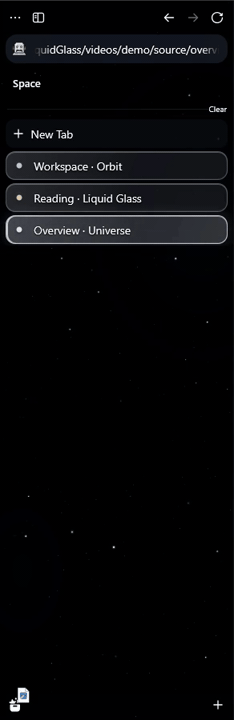

# Universe Liquid Glass

A small universe for **Zen Browser**: deep black space, crisp twinkling stars, passing celestial objects and bright **liquid glass** tabs.

[Download](https://github.com/psy-zney/UniverseLiquidGlass/releases/latest) · [Video](#video-demo) · [Tiếng Việt](README.vi.md)

## Video demo

https://github.com/user-attachments/assets/91497d1d-f244-4eb9-b1db-a82097c5d6c2

*53.5 seconds of native Zen footage, with tracked **2.3× close-ups** for celestial events. Sidebar tab switches and everyday controls remain in the full-window view. [Download MP4](media/theme-demo.mp4) · [Vietnamese subtitles](media/theme-demo.vi.srt).*

## Features

- **Deep black sky:** irregular white pinpoints, sharp cores and staggered twinkling, without a purple color scheme.
- **Nine celestial events:** diagonal comet, star, planet, white dwarf, black hole, neutron star, nebula, blue star and spiral galaxy.
- **Moving local light:** halos travel with each source and shine through translucent tabs. The black hole includes an accretion disc and simulated gravitational lensing.
- **Cosmic browser frame:** events appear in the sidebar, top toolbar and exposed top edge in compact mode. Decorative layers stay behind controls and never capture clicks.
- **Liquid glass tabs:** bright reflective borders, a clear active state and a moving loading highlight for the selected busy tab.
- **Readable panels:** wider Downloads, wrapping filenames, explicit foreground/background pairs in Library, Spaces, History and native website select popups.
- **Local assets:** CSS and embedded SVG; the installed theme does not fetch remote images, fonts or scripts.

### What the video shows

| Time | Scene |
| --- | --- |
| 00:00 | Deep black interface and glass tabs |
| 00:03–00:34 | All nine celestial events, with magnified details as each object passes |
| 00:34–00:42 | Switching between three tabs in the sidebar |
| 00:42–00:45 | The selected-tab loading state |
| 00:45–00:49 | Readable Downloads panel |
| 00:49–00:54 | Installation steps |

The video uses a dedicated Zen profile, local sample pages and synthetic download entries. Event timing is edited for a compact showcase; the installed sidebar loop takes **70 seconds**, and the top loop **84 seconds**. Magnified detail panels are part of the video edit, not overlays added to the theme.

<details>
<summary>Quick animated sidebar preview</summary>



</details>

## Quick installation — Windows

1. Download **UniverseLiquidGlass-v1.0.0.zip** from [Releases](https://github.com/psy-zney/UniverseLiquidGlass/releases/latest) and extract it.
2. If you have multiple Zen profiles, open `about:profiles` and note the intended profile's **Root Directory**.
3. **Close Zen completely**, then run `install.cmd` from the extracted folder.
4. Reopen Zen with the **Dark** appearance and expanded vertical tabs.

The installer automatically selects a profile only when there is exactly one. For a specific profile, run this from the extracted folder:

```powershell
.\install.cmd -ProfilePath "C:\path\to\your\Zen\profile"
```

Preview the changes without writing files:

```powershell
powershell -NoProfile -ExecutionPolicy Bypass -File .\install.ps1 -ProfilePath "C:\path\to\your\Zen\profile" -WhatIf
```

### What the installer changes

- Backs up `chrome/userChrome.css`, `chrome/userContent.css`, `user.js` and the previous managed theme, if present, in `.universe-liquid-glass-backups/<timestamp>/` inside the profile.
- Copies the theme into `chrome/UniverseLiquidGlass/` and adds one import to each entry CSS file. Your existing custom CSS is preserved.
- Adds a labeled block to `user.js` enabling `toolkit.legacyUserProfileCustomizations.stylesheets`.
- Rejects a locked profile. Bookmarks, passwords, extensions and history are not modified.

Existing theme rules may override this theme. Back up your configuration and disable conflicting theme imports if the appearance differs from the demo.

## Manual installation — Windows, macOS and Linux

1. Open `about:profiles` and find your profile's **Root Directory**. Close Zen.
2. Create `chrome/UniverseLiquidGlass/` inside that profile and copy both files from `theme/` into it.
3. Create or edit `chrome/userChrome.css`. Add this at the start, after `@charset` if present:

   ```css
   @import url("UniverseLiquidGlass/userChrome.css");
   ```

4. In `chrome/userContent.css`, add:

   ```css
   @import url("UniverseLiquidGlass/userContent.css");
   ```

5. In `about:config`, set `toolkit.legacyUserProfileCustomizations.stylesheets` to `true`, then restart Zen.

**Tested on Zen 1.23.2b / Windows.** Manual installation on macOS/Linux is documented but has not been tested directly. The [official Zen Mods repository is archived](https://github.com/zen-browser/theme-store), so this theme is **not yet submitted or listed**. A [review bundle and submission status](zen-store-submission.md) are available; use Releases for installation in the meantime.

## Uninstall and restore

Close Zen, then run `uninstall.cmd`, or select the profile explicitly:

```powershell
.\uninstall.cmd -ProfilePath "C:\path\to\your\Zen\profile"
```

The uninstaller removes managed imports and theme files while preserving unrelated custom CSS, edits made after installation and backups. Zen may retain the CSS-enabled preference in `prefs.js`; it no longer loads this theme once the imports are removed.

For a manual installation, remove the two imports and `chrome/UniverseLiquidGlass/`. To restore the exact previous configuration, use the backed-up files while Zen is closed.

## Customize and build

```text
theme/                   Ready-to-use CSS
src/sidebar.css          Star layers and sidebar motion
src/cosmic_events.py      Celestial objects, lighting and event schedule
src/deep_space_assets.py  Star field and SVG details
src/ui.css               Glass tabs, top bar, Library and popups
scripts/build.py         Deterministic CSS generator, Python standard library only
videos/demo/             Timeline, local demo pages, native recorder and video edit
```

```powershell
python scripts/build.py
powershell -NoProfile -ExecutionPolicy Bypass -File scripts/test-install.ps1
powershell -NoProfile -ExecutionPolicy Bypass -File scripts/package.ps1
```

Edit `SCHEDULE` in `src/cosmic_events.py` to change event timing, then rebuild. Adjust `.tab-background` surfaces and borders in `src/ui.css` to change glass brightness. See [video source](../videos/demo/README.md) to reproduce the recording and tracked close-ups.

## Notes

- Black-hole lensing and illumination are graphical approximations, not a complete physical simulation.
- Contrast fixes cover the tested Zen panels and native select popups. Arbitrary websites are not forced into a global color scheme.
- Compact mode keeps its native behavior; when the toolbar is hidden, events appear in the remaining exposed top edge.
- Blur and animation costs depend on your GPU. Zen updates may change the selectors used by this theme.

MIT · [psy-zney](https://github.com/psy-zney)
